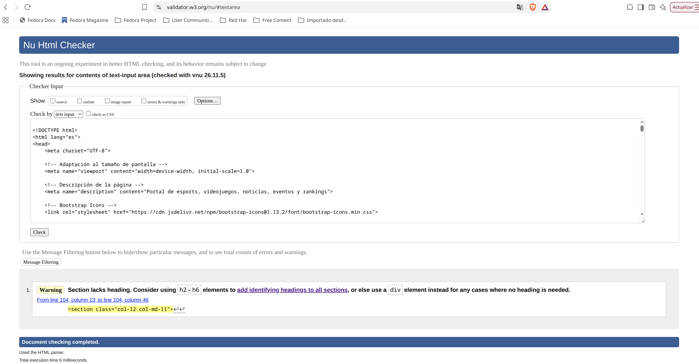
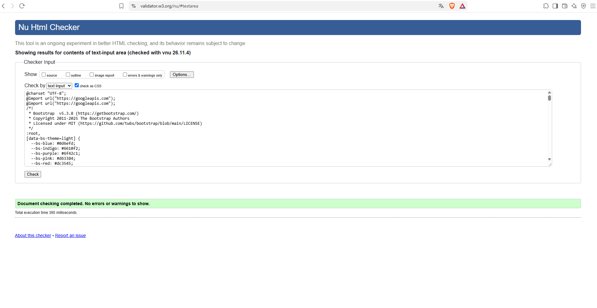

He hecho la página de inicio (index.html) y la página juegos (juegos.html) ya que toda mi web es igual en todas las páginas.
En juegos.html es donde está el filtro, mientras que en index.html no está porque mostraría los eventos y noticias más relevantes, no está pensado para ser filtrado.

Al hecer los checks, los html salían todos con el mismo warning que intentamos mirar en clase y no conseguimos solucionar, el warning sobre que el section debe tener un header o un div en su defecto.

Check del index.html

Check de juegos.html

Check de miestilo.css

Tal y como hablamos en clase, mi página no tiene un modo oscuro y un modo claro ni un inicio de sesión. 
En su lugar he añadido un validador en el buscador de forma que no deja enviar una busqueda vacía o solo con espacios.
